# FabriLink (ফ্যাব্রি-লিংক) — B2B Garment Surplus Fabric Marketplace

> **A production-grade B2B web platform connecting export-oriented readymade garment (RMG) factories in Bangladesh holding surplus fabric rolls with small boutiques, fashion startups, and independent designers needing small-batch custom yardage.**

---

## ⚡ Quickstart: Run the Project Right Now

If the repository environment is already installed, open **two terminal windows**:

### Terminal 1: Backend (Django API)
```bash
# 1. Activate the virtual environment
source .venv/bin/activate

# 2. Start the Django server on port 8000
python backend/manage.py runserver 0.0.0.0:8000
```
> **Backend is live at:** [http://localhost:8000](http://localhost:8000)  
> **Interactive Swagger API Docs:** [http://localhost:8000/api/docs/](http://localhost:8000/api/docs/)

---

### Terminal 2: Frontend (React + Vite)
```bash
# 1. Navigate to the frontend directory
cd frontend

# 2. Start the Vite dev server
npm run dev
```
> **Frontend is live at:** [http://localhost:5173](http://localhost:5173)

---

## 🔑 Demo Login Credentials & Portals

The database comes pre-seeded with test accounts for each role. You can log in immediately:

| Role | Portal URL | Email | Password | What You Can Test |
|---|---|---|---|---|
| **Central Admin** | [http://localhost:5173/admin/kyc](http://localhost:5173/admin/kyc) | `admin@fabrilink.com.bd` | `Admin12345!` | Audit Trade Licenses, approve/reject factory & boutique KYC |
| **Django Admin** | [http://localhost:8000/admin/](http://localhost:8000/admin/) | `admin@fabrilink.com.bd` | `Admin12345!` | Low-level database management, raw models, ledger inspect |
| **Garment Mill (Factory)** | [http://localhost:5173/factory/dashboard](http://localhost:5173/factory/dashboard) | `sales@squarefashions.com` | `Factory12345!` | View surplus fabric listings, pickup schedules, payouts statement |
| **Boutique Buyer** | [http://localhost:5173/catalog](http://localhost:5173/catalog) | `buyer@dhakatrendz.com` | `Buyer12345!` | Browse rolls, request roll breakdown cuts, cart, order tracking |
| **Cutting Hub Operator** | [http://localhost:5173/hub/queue](http://localhost:5173/hub/queue) | `hub@fabrilink.com.bd` | `Hub12345!` | Inspect received rolls, scan barcodes, complete precision cuts |

> Run `python backend/manage.py seed_demo` once after pulling to create the hub account and activate the demo buyers' credit lines.

## 📱 Mobile app (iOS & Android)

The Expo app lives in [`mobile/`](mobile/README.md). On Windows, double-click `start-backend.cmd` (this folder) and then `mobile\start-mobile.cmd`, and scan the QR code with your phone (same Wi-Fi).

> **Language Toggle**: You can switch between **Bangla (বাংলা)** and **English (EN)** at any time using the language toggle in the top-right navbar!

---

## 📦 Complete Setup from Scratch (Fresh Install)

If setting up on a brand new machine or cloning freshly:

### Prerequisites
- **Python**: 3.12+
- **Node.js**: 20+ or 22+ with `npm`
- **Git**
- Optional: Astral `uv` (recommended for 10x faster Python package installation)

---

### Option 1: Standard Python (`venv` + `pip`) & `npm`

#### 1. Backend Setup
```bash
# 1. Clone and enter the project folder
cd "GarmentsFabric X"

# 2. Create and activate Python virtual environment
python3 -m venv .venv
source .venv/bin/activate

# 3. Install backend dependencies
pip install --upgrade pip
pip install -r backend/requirements/development.txt

# 4. Copy environment configuration
cp .env.example .env

# 5. Run Database Migrations
python backend/manage.py migrate

# 6. Seed Demo Data (Factories, Boutiques, Categories, and Fabric Rolls)
python backend/manage.py seed_demo

# 7. Start Backend Server
python backend/manage.py runserver 0.0.0.0:8000
```

#### 2. Frontend Setup (New Terminal)
```bash
# 1. Navigate to frontend directory
cd frontend

# 2. Install dependencies
npm install

# 3. Start development server
npm run dev
```

---

### Option 2: Fast Setup with Astral `uv` (Recommended for Python)
```bash
# Install uv (if not already installed)
curl -LsSf https://astral.sh/uv/install.sh | sh

# Setup backend with uv
uv venv .venv
source .venv/bin/activate
uv pip install -r backend/requirements/development.txt

# Migrate and seed
python backend/manage.py migrate
python backend/manage.py seed_demo
python backend/manage.py runserver 0.0.0.0:8000
```

---

### Option 3: Using `make` Commands
If you have `make` installed on your machine:
```bash
# Complete setup
make install          # Creates .venv and installs backend packages
make frontend-install # Installs frontend npm packages
make migrate          # Runs database migrations
make seed             # Populates demo accounts, categories, and fabric rolls

# Run servers
make dev              # Starts Django server on port 8000
make frontend-dev     # Starts Vite server on port 5173
```

---

### Option 4: Full-Stack Docker Compose (PostgreSQL + Redis + Celery + Django + Vite)
If you prefer running everything in isolated Docker containers:
```bash
# 1. Build and start all services in the background
docker compose up --build -d

# 2. Run database migrations inside container
docker compose exec backend python manage.py migrate

# 3. Seed demo data
docker compose exec backend python manage.py seed_demo

# 4. View live logs
docker compose logs -f

# 5. Stop all containers when finished
docker compose down
```

---

## 🌐 Application URL Reference

### Frontend (`http://localhost:5173`)
| Route | Page Name | Description |
|---|---|---|
| `/` | Landing Page | Hero showcase, value proposition, quick stats |
| `/catalog` | Surplus Fabric Catalog | Filter by material, GSM, weave, color, factory, price |
| `/catalog/:id` | Fabric Detail & Breakdown | Full roll specs, interactive breakdown calculator & checkout |
| `/login` | Sign In | Role-aware login with instant redirect to user's dashboard |
| `/register` | Sign Up | Registration with Trade License & BIN file uploads |
| `/approval-pending` | KYC Pending | Status screen for accounts awaiting admin verification |
| `/buyer/requests` | Sourcing Requests | Post fabric you can't find; mills see it and build a profile for you |
| `/buyer/credit` | B2B Credit Line | Limit, unsettled credit orders and what's left to spend |
| `/factory/requests` | Buyer Requests | Open sourcing requests from boutiques, one click to build a custom profile |
| `/admin/matching` | Sourcing Requests | Every request on the platform |
| `/admin/companies` | Company Directory | Verified mills and boutiques |
| `/buyer/orders` | Boutique Orders | Live order tracking timeline, cuts breakdown, download receipts |
| `/factory/dashboard` | Factory Dashboard | Surplus roll inventory, pickup status, earnings & payout ledger |
| `/hub/queue` | Cutting Hub Queue | Hub receiving workflow, cutting tasks, waste tracking |
| `/admin/kyc` | Admin Verification | Review pending factory & boutique trade licenses |

### Backend (`http://localhost:8000`)
| Route | Description |
|---|---|
| `/api/v1/` | Base API namespace |
| `/api/v1/matching/requests/` | Sourcing requests (`GET`/`POST`; `…/<id>/matches/`, `…/<id>/close/`) |
| `/api/v1/orders/credit/` | Buyer's B2B credit summary |
| `/api/docs/` | Interactive Swagger UI (test endpoints live) |
| `/api/redoc/` | ReDoc API documentation |
| `/api/schema/` | Raw OpenAPI 3.0 schema |
| `/admin/` | Django Admin site |
| `/health/` | Health check endpoint |

---

## 🧪 Testing & Code Quality

### 1. Run Backend Pytest Suite
```bash
# Run all unit and service tests with coverage
.venv/bin/pytest

# Or via make
make test
```

### 2. Run Backend Code Linters
```bash
# Check with Ruff
.venv/bin/ruff check backend

# Auto-fix formatting and imports
.venv/bin/ruff check backend --fix && .venv/bin/black backend
```

### 3. Run Frontend Typecheck & Build
```bash
cd frontend
npm run build
```

---

## 🏗️ Architecture & Core Business Rules

```mermaid
flowchart LR
    A["Factory lists Surplus Roll"] --> B["Boutique filters & requests Breakdown"]
    B --> C["Platform locks Hold & Quotes"]
    C --> D["Payment / Credit Authorized"]
    D --> E["Pickup from Factory Mill"]
    E --> F["Hub Inspection & Precision Cut"]
    F --> G["Barcode Tagged & Packed"]
    G --> H["Courier Delivery to Boutique"]
    H --> I["Settlement & Factory Payout"]
```



### 1. Precision Roll Breakdown Invariant
When a boutique requests a partial cut ($y_{req}$) from a factory roll of total length ($y_{total}$):
- Minimum Cut Requirement: $y_{req} \ge L_{min}$ (default 5–10 yards)
- Remnant Integrity Rule: Leftover fabric ($y_{rem} = y_{total} - y_{req}$) must satisfy:
  $$y_{rem} = 0 \quad \text{OR} \quad y_{rem} \ge L_{min}$$
  This mathematically guarantees that factories are never left with unsellable 1–3 yard scraps.

### 2. Transparent Pricing Formula
Every breakdown order calculates transparently:
$$\text{Total} = (\text{Yardage} \times \text{Price/yd}) + \text{Base Cut Fee (৳150)} + (\text{Yardage} \times \text{৳5/yd}) + \text{Platform Fee (6\%)} + \text{Courier Fee (৳120)} + \text{VAT}$$

### 3. Concurrency Protection
Roll reservations execute within database transactions with row-level locks:
```python
with transaction.atomic():
    roll = FabricRoll.objects.select_for_update().get(id=roll_id)
    # verify yardage availability and create reservation
```

---

## 📁 Repository Structure

```
fabrilink/
├── backend/
│   ├── config/                     # Settings split, URLs, WSGI, Celery
│   │   ├── settings/               # base.py, development.py, test.py, production.py
│   │   ├── urls.py, celery.py
│   ├── apps/
│   │   ├── users/                  # Custom User, UserProfile, JWT auth, RBAC
│   │   ├── companies/              # Mill & Boutique KYC (Trade License, TIN, BIN)
│   │   ├── catalog/                # FabricCategory, FabricType, FabricRoll, Images
│   │   ├── inventory/              # StockReservation, StockLedger (append-only)
│   │   ├── orders/                 # Cart, Order, OrderItem, Tracking, breakdown logic
│   │   ├── hub/                    # Hub receiving, cutting jobs, barcode labels
│   │   ├── shipping/               # Factory pickup schedules, couriers (Steadfast/RedX)
│   │   ├── payments/               # bKash, Nagad, SSLCommerz, B2B credit, payouts
│   │   ├── matching/               # Algorithmic buyer request ↔ roll cross-matcher
│   │   ├── samples/                # Swatch / test-cut sample requests
│   │   ├── promotions/             # Discount codes and volume campaigns
│   │   ├── notifications/          # In-app, SMS, and email alerts
│   │   └── reports/                # Admin sales, turnover, and hub waste analytics
│   ├── common/                     # Permissions, pagination, custom exceptions
│   ├── requirements/               # base.txt, development.txt, production.txt
│   ├── schema.json, schema.yaml    # OpenAPI 3.0 specification
│   └── manage.py, pyproject.toml
│
├── frontend/
│   ├── src/
│   │   ├── app/                    # router.tsx, providers.tsx, layouts/, guards/
│   │   ├── api/                    # client.ts (Axios + auto token refresh), generated.ts
│   │   ├── features/
│   │   │   ├── auth/               # LoginPage, RegisterPage, PendingApprovalPage, store.ts
│   │   │   ├── catalog/            # CatalogBrowsePage, FabricDetailPage (calculator)
│   │   │   ├── buyer-dashboard/    # BuyerOrdersPage (tracking timeline & receipts)
│   │   │   ├── factory-dashboard/  # FactoryDashboardPage
│   │   │   ├── hub/                # HubQueuePage
│   │   │   └── admin/              # AdminKYCPage
│   │   ├── components/shared/      # Navbar, Footer
│   │   ├── i18n/                   # locales/bn.json, locales/en.json, index.ts
│   │   ├── lib/utils.ts            # formatBDT, cn helper
│   │   └── main.tsx, index.css
│   ├── package.json, vite.config.ts, tailwind.config.js
│
├── docker-compose.yml              # Multi-container stack (web, worker, beat, postgres, redis, frontend)
├── Makefile                        # Dev shortcuts (install, dev, migrate, seed, test, lint)
├── .env.example                    # Environment variable template
└── README.md                       # This guide
```

---

## 🛠️ Common Questions & Troubleshooting

### Q: "Port 8000 or 5173 is already in use"
Check which process is using the port and terminate it if needed:
```bash
# Check port 8000 (Backend)
lsof -i :8000
# Kill process if necessary: kill -9 <PID>

# Check port 5173 (Frontend)
lsof -i :5173
# Kill process if necessary: kill -9 <PID>
```

### Q: How do I create my own admin superuser?
```bash
python backend/manage.py createsuperuser
```
Enter your desired email (e.g. `myadmin@fabrilink.com.bd`), full name, phone number, and password.

### Q: How do I re-seed or reset demo data?
```bash
python backend/manage.py seed_demo
```
This safely updates or recreates demo mills (Square, Ha-Meem, Beximco), boutique buyers (Dhaka Trendz), categories, and surplus rolls with realistic images and prices.

---

## 📜 Compliance & License
Built for Bangladesh's RMG and textile export sector. All surplus listings conform to BGMEA / BKMEA export quality grades and domestic trade licensing compliance.


Email / Username: admin@fabrilink.com.bd
Password: Admin12345!
